# EnergyPeak Predictor — Day 27 / 100 Projects

**Research-first · honest held-out evaluation · one-step energy forecasting · FastAPI + React**

[GitHub](https://github.com/MENSTRUE/EnergyPeak-Predictor) · [Notebook](notebooks/energypeak-predictor.ipynb) · [Research report](reports/evaluation/research_gate.json)

## Contents
1. Project identity and research contract
2. Before — Now — Next
3. Research problem and objective
4. Scope and claim boundaries
5. Dataset inventory and source provenance
6. Data audit and leakage controls
7. Chronological splitting and feature engineering
8. Experiment design and champion selection
9. Held-out evaluation metrics
10. Visual evidence — screenshots and all plots
11. Application architecture and API
12. Repository structure
13. Reproducibility and execution
14. Backend and frontend testing
15. Local deployment and production checklist
16. Limitations and threats to validity
17. Troubleshooting
18. Roadmap
19. FAQ
20. License and data rights
21. Source-of-truth files

## 01. Project identity and research contract

Day 27 / 100 Projects. EnergyPeak Predictor is a research-oriented, one-step-ahead electricity and energy consumption forecasting project with a threshold-based peak flag. The saved Kaggle research, local FastAPI read API, and React/Vite research console are separate stages. Historical held-out rows are retrospective evaluation, not continuous forecasting.

## 02. Before — Now — Next

**Before:** audited three UCI-source datasets; created lag/rolling features from past observations; chronological splits; trained candidate models and selected each champion on validation MAE; exported held-out metrics, forecasts, plots, model manifest and 14 champions. **Now:** repository publishes notebook, reports, 14 plots, 4 screenshots and full-stack prototype; the local UI has shown API connected and historical data, while model loading has exposed an environment mismatch. **Next:** pin a verified compatible inference environment, test full 21-feature vectors, validate every route, run independent domain drift and near-duplicate checks, and only then consider controlled deployment.

## 03. Research problem and objective

Demand peaks may matter for planning, but an attractive chart is not a trustworthy forecast. The measurable objective is to predict the next observation using genuinely available historical context and evaluate whether forecasts exceed the **training-only 90th percentile**. Regression and derived peak classification are reported separately.

## 04. Scope and claim boundaries

Supported: within-series, one-step-ahead retrospective evaluation, saved Kaggle metrics, trained champion selection on validation MAE, threshold-derived peak indicators. Unsupported: real-time IoT sensing, day-ahead dispatch, tariff/cost savings, peak guarantees, generic forecasts from timestamp alone, grid actuation or validated external generalization. Never equate model presence with successful deserialization or prediction readiness.

## 05. Dataset inventory and source provenance

**Primary — UCI Steel Industry Energy Consumption**: a single industrial facility; `Usage_kWh` target, 15-minute cadence. **Secondary — UCI ElectricityLoadDiagrams20112014**: 370 consumer streams available in the source; default notebook benchmarks 12 selected `MT_###` streams, each evaluated separately at 15-minute cadence, not the entire population. **Auxiliary — UCI Appliances Energy Prediction**: residential domain, `Appliances` target at 10-minute cadence. Dataset bundle observed in the Kaggle run at `/kaggle/input/datasets/loliwibu/energypeak-predictor-dataset`. Sources, filenames, intervals and roles are encoded in `reports/evaluation/source_provenance.csv`, `input_inventory.csv`. UCI dataset rights require checking source-specific terms; MIT software license does not relicense their data.

| Dataset | Source | Interval | Role |
|---|---|---|---|
| Steel Industry | [UCI 851](https://archive.ics.uci.edu/dataset/851/steel+industry+energy+consumption) | 15 min | Primary / Primer |
| ElectricityLoadDiagrams | [UCI 321](https://archive.ics.uci.edu/dataset/321/electricityloaddiagrams20112014) | 15 min | Secondary / Sekunder |
| Appliances Energy Prediction | [UCI 374](https://archive.ics.uci.edu/dataset/374/appliances+energy+prediction) | 10 min | Auxiliary / Pendukung |

## 06. Data audit and leakage controls

Inspect timestamp parsing, ordering, duplicates, missing intervals, outliers, units, series coverage, and minimum usable history. `research_gate.json` records PASS_REPRODUCIBILITY and flags chronological splits, training-only cutoffs, validation-only selection and source separation. This is an automated notebook gate, not external independent verification. Past-only features must be reconstructed at inference; do not let contemporaneous target or future exogenous observations slip into the input vector. Adjacent timestamps are autocorrelated even without exact duplicates.

## 07. Chronological splitting and feature engineering

Each series uses 60% train / 20% validation / 20% untouched test, in time order and without shuffling. Run seed: 42. Configured lags: `1,2,3,4,8,12,24,48,96`; rolling windows: `4,12,48,96`; candidate vectors contain 21 features. The meaning of lag 96 depends on cadence: 24 hours for 15-minute data but 16 hours for 10-minute data. Confirm rolling is shifted and uses preceding measurements, and temporal fields reflect actual forecast-time availability.

## 08. Experiment design and champion selection

The notebook compares candidate regressors including seasonal/lag baselines, hist-gradient boosting and `random_forest_160`. Each series is treated independently, not concatenated across domains. Candidate comparisons live under `reports/evaluation/*_validation_candidates.csv`, full experiment records under `reports/experiments/all_experiment_metrics.csv`. Choose the winner **only by validation MAE**, then inspect a single held-out test result. No choosing a champion from test F1, test MAE, or screenshots.

## 09. Held-out evaluation metrics

Source: `reports/evaluation/{steel,appliances,electricity_MT_###}_heldout_metrics.json`. **Steel** (`random_forest_160`, 6,989 test rows, kWh): MAE **3.9369**, RMSE **8.3710**, sMAPE **12.3215%**, Peak F1 **0.7314**, training P90 **83.74 kWh**. **Appliances** (`hist_gradient_boosting`, 3,928 test rows, source-original energy units): MAE **25.3261**, RMSE **57.5269**, sMAPE **20.4713%**, Peak F1 **0.7117**. **Electricity MT_156** (`hist_gradient_boosting`, 28,032 test rows, source-original units): MAE **4.5920**, RMSE **6.5115**, sMAPE **5.7733%**, Peak F1 **0.9467**. Peak F1 uses a threshold set on train P90 and does not independently validate grid failures. Do not rank MAE across incomparable target units or domains.

| Series | Champion | Test rows | MAE | RMSE | sMAPE | Peak F1 |
|---|---|---:|---:|---:|---:|---:|
| Steel | Random Forest (160) | 6,989 | 3.9369 kWh | 8.3710 | 12.3215% | 0.7314 |
| Appliances | HistGradientBoosting | 3,928 | 25.3261* | 57.5269 | 20.4713% | 0.7117 |
| Electricity MT_156 | HistGradientBoosting | 28,032 | 4.5920* | 6.5115 | 5.7733% | 0.9467 |

*Source-original units; do not compare directly against steel kWh.

## 10. Visual evidence — screenshots and all plots

The fourteen repository forecast figures show held-out actual versus predicted values for Steel, Appliances and twelve separately evaluated Electricity consumer streams. Four saved UI screenshots show the research console; neither plots nor screenshots establish live performance or model-loading readiness.

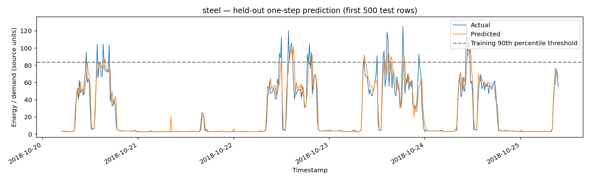
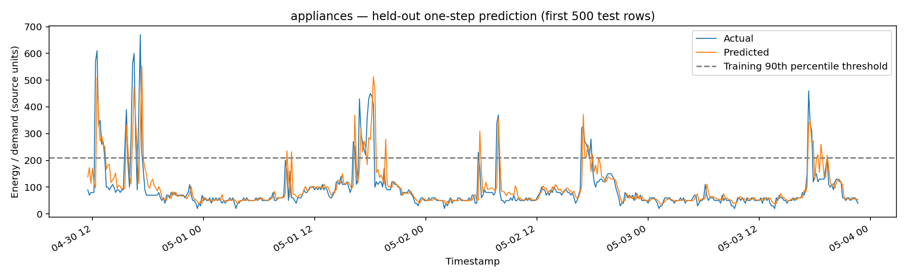
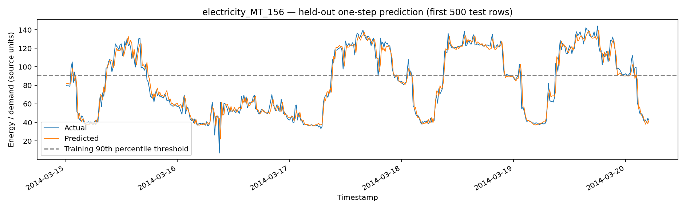
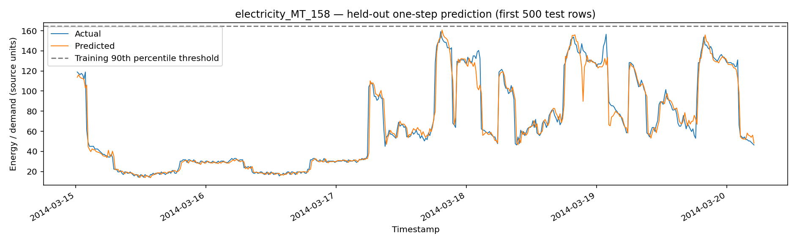
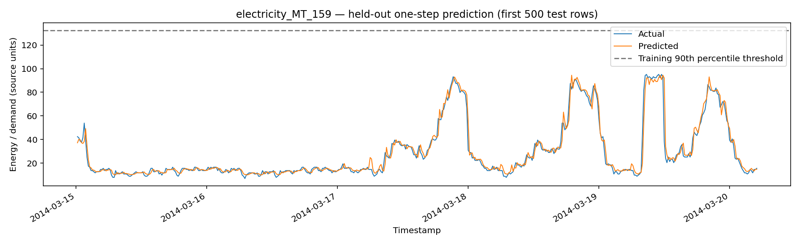
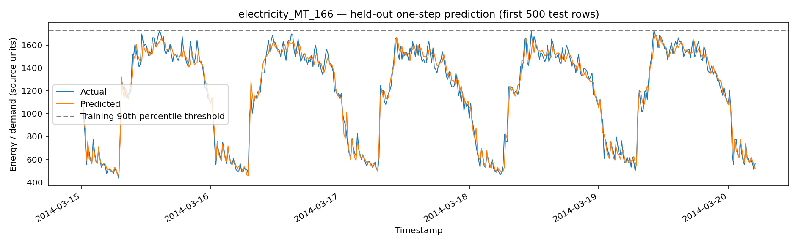
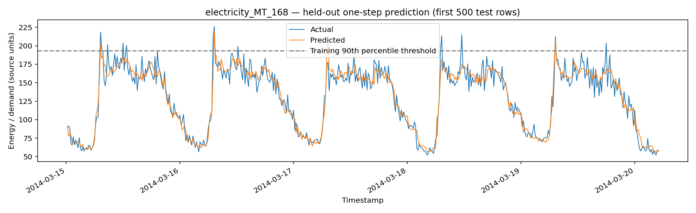
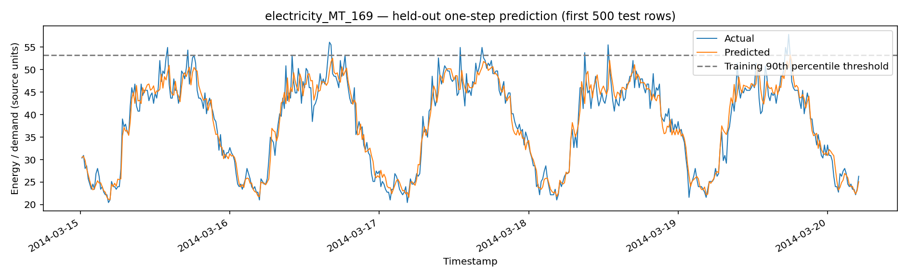
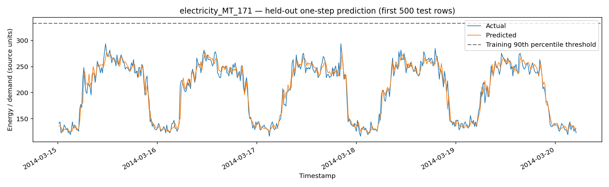
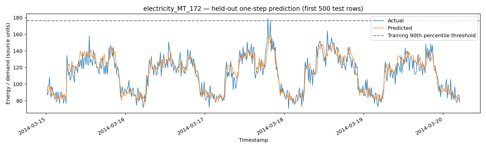
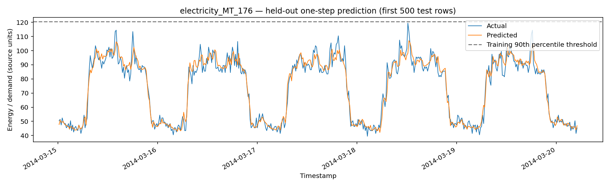
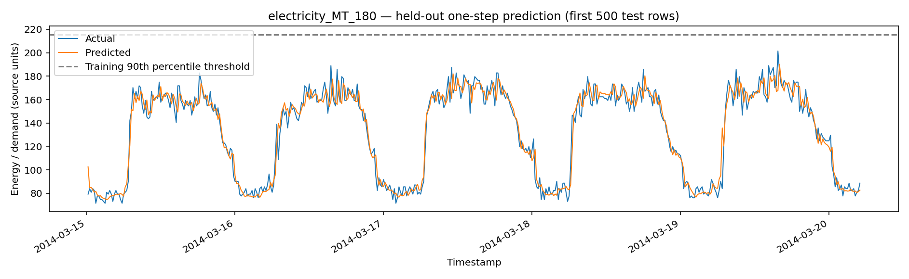
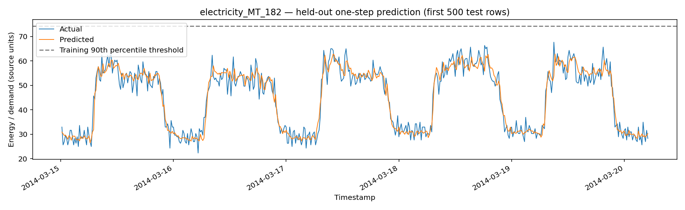
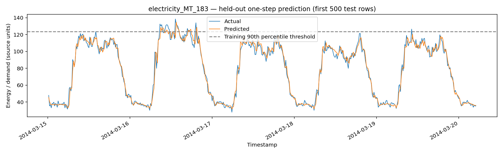


## 11. Application architecture and API

**Research layer:** Kaggle notebook creates reports and serialized artifacts. **API:** FastAPI serves health, series inventory, saved metrics, paginated forecast samples, audit/manifest reports and conditional model inspection/prediction. **UI:** React + Vite + TypeScript exposes Overview, Forecast Explorer, Model Inference and Research & Audit. Reports are read-only snapshots. `GET /api/v1/health`, `/api/v1/series`, `/api/v1/series/{series_id}/metrics`, `/api/v1/series/{series_id}/forecast`, `/api/v1/reports/model-manifest`, `/api/v1/reports/{name}`, `/api/v1/models/{series_id}`, `POST /api/v1/predict/{series_id}`. Inference requires the trusted local joblib, exact named historical features, and compatible sklearn version.

## 12. Repository structure

`notebooks/` research master; `data/{raw,interim,processed,external}/` ignored local datasets; `models/{baseline,champion}/` local artifacts (not committed); `reports/{audit,evaluation,experiments,forecasts}/` saved results; `assets/plots/` fourteen real forecast PNGs; `assets/screenshots/` four app captures; `backend/app/` FastAPI; `frontend/src/` React; `docs/{en,id}/` paired documentation; `scripts/` helpers; `tests/` checks; `LICENSE` MIT. See `docs/en/repository-map.md` for a fuller map.

```text
EnergyPeak Predictor/
├── README.md / AGENTS.md / LICENSE
├── notebooks/energypeak-predictor.ipynb
├── data/{raw,interim,processed,external}/
├── models/{baseline,champion}/ (local ignored artifacts)
├── reports/{audit,evaluation,experiments,forecasts}/
├── assets/{plots,screenshots,diagrams,examples}/
├── backend/{app,tests}/
├── frontend/src/{components,pages,services,styles,types}/
├── docs/{en,id}/
├── scripts/
└── tests/
```

## 13. Reproducibility and execution

Input root: `/kaggle/input/datasets/loliwibu/energypeak-predictor-dataset` at research time; use `notebooks/energypeak-predictor.ipynb`. Run config records Kaggle Python **3.13.15** and seed **42**; do not assume that notebook Python and local Windows Python match. Record pandas, NumPy, scikit-learn, joblib and model export versions before re-running. Source is auditable through `source_provenance.csv`, `input_inventory.csv`, `run_config.json`, `research_gate.json`. Outputs need comparison via metrics and hashes to call a rerun reproduced; a PASS gate alone is insufficient.

## 14. Backend and frontend testing

Backend: `cd backend`, activate Python virtual environment, `python -m pytest -q`, `python -m uvicorn app.main:app --reload --host 127.0.0.1 --port 8000`; check `/docs` and `/api/v1/health`. Frontend: `cd frontend`, `npm install`, `npm run build`, `npm run dev`; inspect `http://127.0.0.1:5173`. Manual integration: exercise each series, forecast pagination and empty states, model schema and a legitimate 21-feature input, research gate and error handling. Screenshots show local application views, not proof all routes/models pass.

## 15. Local deployment and production checklist

Local-first. Store trusted champions in `models/champion/` and reports in committed `reports/`. Keep `.env` secret, set narrowly scoped CORS origins, and limit network binding to localhost during research. Before internet-facing deployment require authentication, request throttling, HTTPS, resource budgets, security tests, monitoring and source-data permissions; large Random Forest artifacts can consume hundreds of MB each. No production validation is claimed.

```powershell
cd backend
py -3.11 -m venv .venv
.\.venv\Scripts\Activate.ps1
python -m pip install -r requirements.txt
python -m pytest -q
python -m uvicorn app.main:app --reload --host 127.0.0.1 --port 8000
```

```powershell
cd frontend
npm install
npm run build
npm run dev
```

## 16. Limitations and threats to validity

Chronological holdout is internal, not external validation; seasonal/regime shifts may invalidate historical performance. Feature engineering depends on measurement availability, warm-up windows and correct units. Electricity experiment covers selected 12 of 370 clients, not every customer. The residential dataset uses 10-minute intervals. No uncertainty calibration, confidence intervals, live connectivity, grid dispatch, tariff savings or operational guarantee. Peak classification derives from predictions and threshold, not separately audited outage labels.

## 17. Troubleshooting

**API offline:** start backend in its venv and verify health. **CORS:** validate `VITE_API_BASE_URL` and backend allowed origins. **404 metrics:** restore CSV/JSON to exact report paths. **503 missing model:** local `models/champion/{series_id}_champion.joblib` absent. **503 `ModuleNotFoundError: _loss`:** artifact serialized under scikit-learn 1.6.1 but backend previously ran 1.9.1; install/test compatible pinned environment rather than suppressing errors. **Mixed model availability:** filesystem presence != successful `joblib.load`. **422 feature mismatch:** inspect exact `feature_columns` then reconstruct lag/rolling features without future observations. **RAM pressure:** load one large RF at a time. **npm audit:** review advisories and test changes, avoid blind `--force`.

## 18. Roadmap

**P0:** compatible joblib environment and model smoke tests across all 14 series; verify each exact feature vector. **P1:** automated end-to-end report/plot consistency tests, runtime API/UI checks and provenance/hashes. **P2:** rolling-origin and seasonal robustness, near-duplicate investigation, unseen-series/domain drift checks. **P3:** bounded input orchestration and guarded pilot; no automatic energy control without independent operational studies.

## 19. FAQ

**Is this live forecasting?** No, the displayed forecast explorer is historical held-out evaluation. **Does 14/14 mean 14 models load?** No, it counts files; loading must be tested separately. **Are the three datasets fused?** No, experiments preserve domain and cadence. **Why Peak F1?** A train-P90 event proxy complements MAE; it does not measure grid emergency. **Can I forecast using date only?** No, saved estimators require exact historical features. **Is the source data included?** No, fetch it subject to its original rights and provenance. **Is the software production-ready?** No.

## 20. License and data rights

Repository software: MIT, see [`LICENSE`](LICENSE). Copyright 2026 Wafa Bila Syaefurokhman. Third-party UCI data, Kaggle packaging, images and other dependencies retain their respective licenses. Verify dataset reuse terms before redistribution; do not assume MIT covers the datasets or trained artifacts from them.

## 21. Source-of-truth files

Numerical results: `reports/evaluation/*_heldout_metrics.json`; detailed validation candidate comparisons: `reports/evaluation/*_validation_candidates.csv`; experiment inventory: `reports/experiments/all_experiment_metrics.csv`; historical forecast CSV: `reports/forecasts/*_heldout_predictions.csv`; champion manifest: `reports/audit/model_manifest.csv`; methodology configuration: `reports/evaluation/run_config.json`; constraints: `reports/evaluation/claim_boundaries.json`; readiness gate: `reports/evaluation/research_gate.json`; exact source attribution: `reports/evaluation/source_provenance.csv`; code: `notebooks/energypeak-predictor.ipynb`, `backend/app/`, `frontend/src/`. This README is an index, not a replacement for these data artifacts.
