# Visual Evidence — EnergyPeak Predictor

This document expands the corresponding source-of-truth sections in the root README. All figures and limitations refer to saved repository outputs.

## Visual evidence — screenshots and all plots

The fourteen repository forecast figures show held-out actual versus predicted values for Steel, Appliances and twelve separately evaluated Electricity consumer streams. Four saved UI screenshots show the research console; neither plots nor screenshots establish live performance or model-loading readiness.

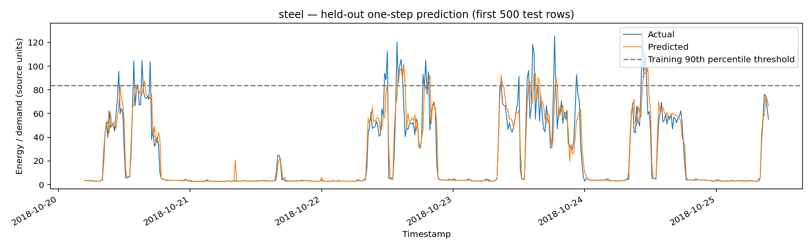
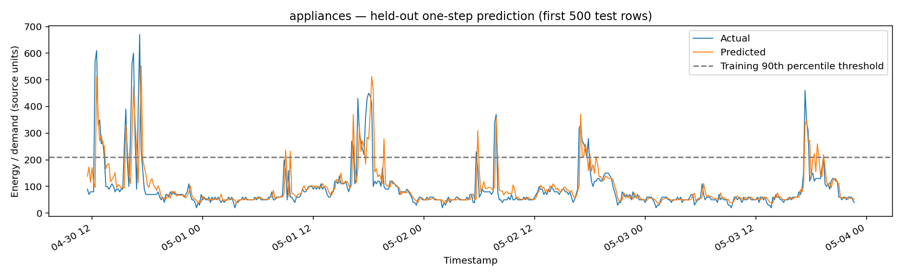
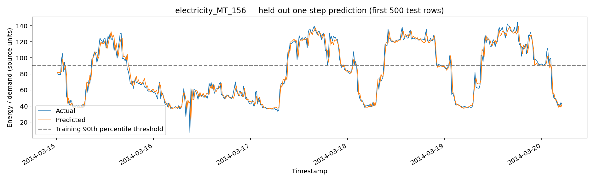
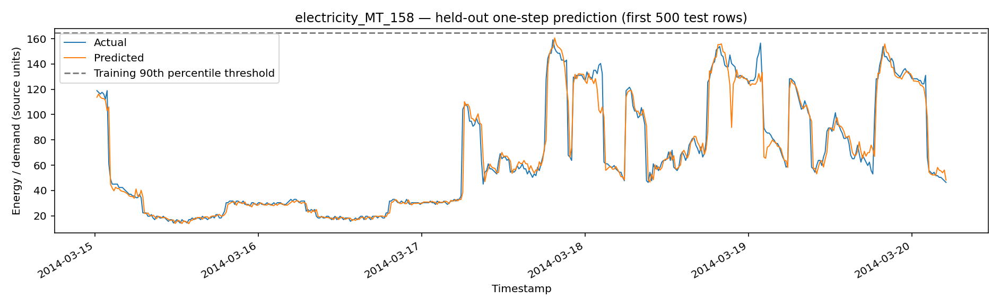
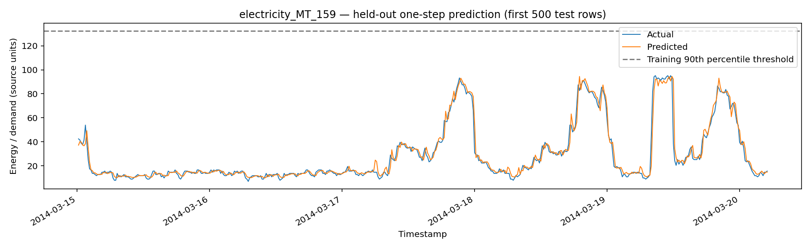
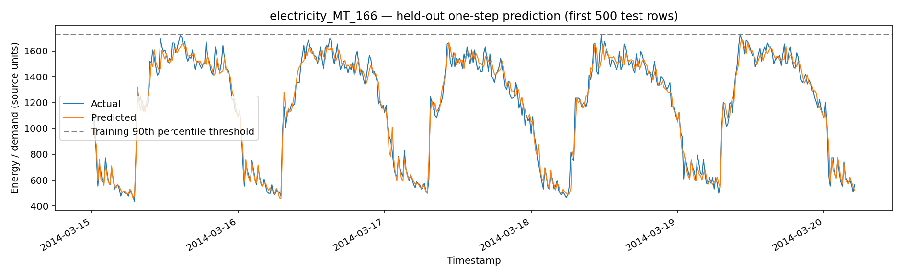
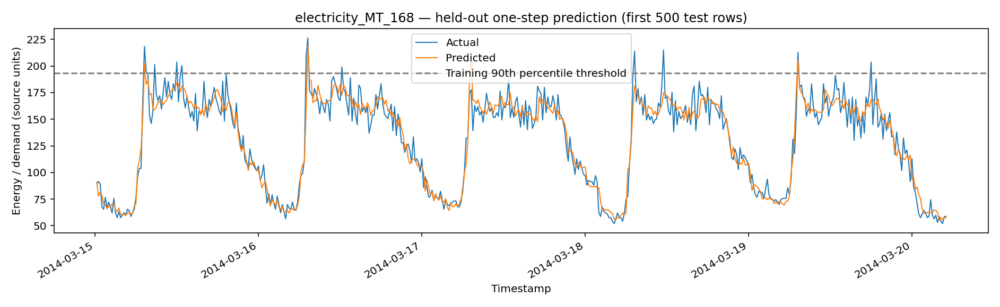
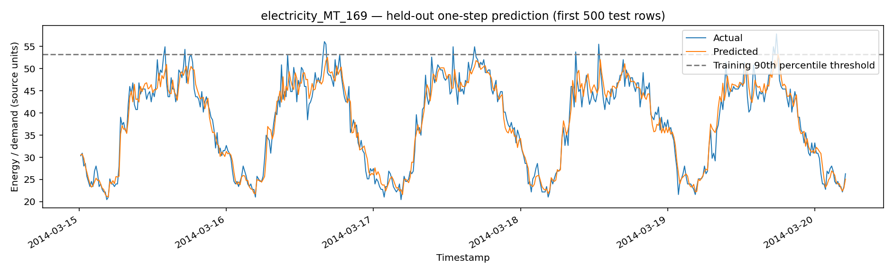
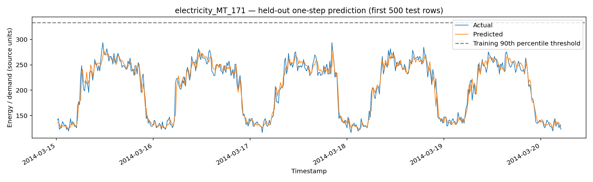
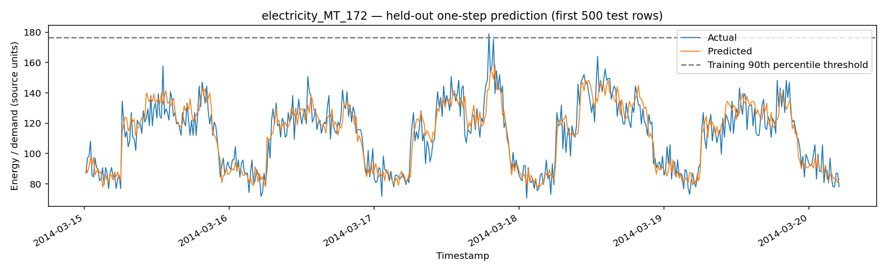
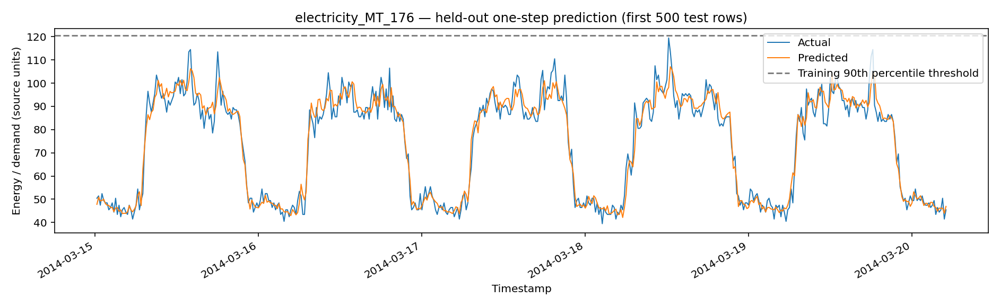
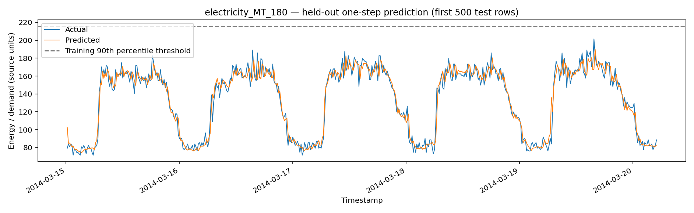
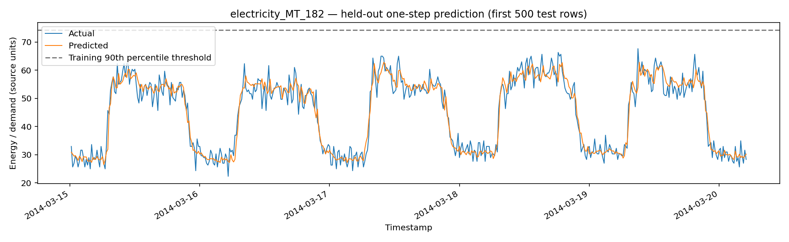
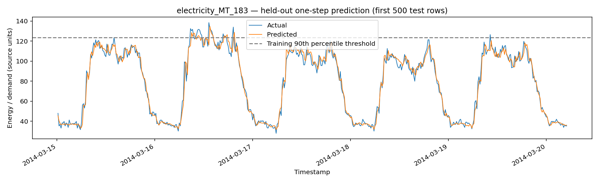

## Source-of-truth files

Numerical results: `reports/evaluation/*_heldout_metrics.json`; detailed validation candidate comparisons: `reports/evaluation/*_validation_candidates.csv`; experiment inventory: `reports/experiments/all_experiment_metrics.csv`; historical forecast CSV: `reports/forecasts/*_heldout_predictions.csv`; champion manifest: `reports/audit/model_manifest.csv`; methodology configuration: `reports/evaluation/run_config.json`; constraints: `reports/evaluation/claim_boundaries.json`; readiness gate: `reports/evaluation/research_gate.json`; exact source attribution: `reports/evaluation/source_provenance.csv`; code: `notebooks/energypeak-predictor.ipynb`, `backend/app/`, `frontend/src/`. This README is an index, not a replacement for these data artifacts.

## Held-out evaluation metrics

Source: `reports/evaluation/{steel,appliances,electricity_MT_###}_heldout_metrics.json`. **Steel** (`random_forest_160`, 6,989 test rows, kWh): MAE **3.9369**, RMSE **8.3710**, sMAPE **12.3215%**, Peak F1 **0.7314**, training P90 **83.74 kWh**. **Appliances** (`hist_gradient_boosting`, 3,928 test rows, source-original energy units): MAE **25.3261**, RMSE **57.5269**, sMAPE **20.4713%**, Peak F1 **0.7117**. **Electricity MT_156** (`hist_gradient_boosting`, 28,032 test rows, source-original units): MAE **4.5920**, RMSE **6.5115**, sMAPE **5.7733%**, Peak F1 **0.9467**. Peak F1 uses a threshold set on train P90 and does not independently validate grid failures. Do not rank MAE across incomparable target units or domains.

## Evidence paths

- `reports/evaluation/`
- `reports/forecasts/`
- `reports/experiments/`
- `reports/audit/`
- `notebooks/energypeak-predictor.ipynb`
