# EnergyPeak Predictor — Hari ke-27 / 100 Proyek

**Riset terlebih dahulu · evaluasi held-out jujur · forecasting energi satu langkah · FastAPI + React**

[GitHub](https://github.com/MENSTRUE/EnergyPeak-Predictor) · [Notebook](../../notebooks/energypeak-predictor.ipynb) · [Laporan riset](../../reports/evaluation/research_gate.json)

## Daftar isi
1. Identitas proyek dan kontrak penelitian
2. Sebelum — Sekarang — Berikutnya
3. Masalah dan tujuan penelitian
4. Cakupan dan batas klaim
5. Inventaris dataset dan asal sumber
6. Audit data dan kontrol kebocoran
7. Pembagian kronologis dan rekayasa fitur
8. Desain eksperimen dan pemilihan champion
9. Metrik evaluasi held-out
10. Bukti visual — screenshot dan semua plot
11. Arsitektur aplikasi dan API
12. Struktur repositori
13. Reproduksibilitas dan eksekusi
14. Pengujian backend dan frontend
15. Deployment lokal dan daftar kesiapan produksi
16. Keterbatasan dan ancaman validitas
17. Pemecahan masalah
18. Peta jalan
19. Pertanyaan umum
20. Lisensi dan hak data
21. Berkas sumber kebenaran

## 01. Identitas proyek dan kontrak penelitian

Day 27 / 100 Projects. EnergyPeak Predictor adalah proyek riset prakiraan konsumsi listrik/energi satu langkah ke depan dengan penanda puncak berbasis ambang. Riset Kaggle tersimpan, API baca FastAPI lokal, dan konsol riset React/Vite adalah tahap berbeda. Baris held-out historis adalah evaluasi retrospektif, bukan forecasting berkelanjutan.

## 02. Sebelum — Sekarang — Berikutnya

**Sebelum:** mengaudit tiga dataset bersumber dari UCI; membuat fitur lag/rolling hanya dari observasi masa lalu; membagi data kronologis; melatih kandidat dan memilih champion tiap seri memakai MAE validasi; mengekspor metrik held-out, forecast, plot, manifest, dan 14 champion. **Sekarang:** repositori memublikasikan notebook, laporan, 14 plot, 4 screenshot serta prototipe full-stack; UI lokal sudah memperlihatkan API connected dan data historis, sedangkan loading model menemukan ketidakcocokan environment. **Berikutnya:** kunci environment inferensi yang kompatibel dan teruji, uji vektor 21 fitur, validasi semua endpoint, audit drift domain dan near-duplicate, baru pertimbangkan deployment terbatas.

## 03. Masalah dan tujuan penelitian

Puncak beban dapat relevan bagi perencanaan, tetapi grafik menarik bukan bukti forecast yang tepercaya. Tujuan terukur adalah memprediksi observasi berikutnya dari konteks historis yang benar-benar tersedia dan menilai apakah forecast melampaui **persentil ke-90 dari data train saja**. Regresi dan klasifikasi puncak turunan dilaporkan terpisah.

## 04. Cakupan dan batas klaim

Didukung: evaluasi retrospektif satu langkah per seri, metrik Kaggle tersimpan, pemilihan champion berbasis MAE validasi, serta indikator puncak turunan dari ambang. Tidak didukung: sensor IoT real-time, dispatch day-ahead, penghematan tarif/biaya, jaminan puncak, forecast hanya dari timestamp, aktuasi jaringan, atau generalisasi eksternal terverifikasi. Keberadaan file model tidak boleh disamakan dengan keberhasilan memuat maupun kesiapan inferensi.

## 05. Inventaris dataset dan asal sumber

**Primer — UCI Steel Industry Energy Consumption**: satu fasilitas industri; target `Usage_kWh`, interval 15 menit. **Sekunder — UCI ElectricityLoadDiagrams20112014**: sumber menyediakan 370 seri pelanggan; notebook default menguji 12 seri `MT_###` terpilih secara terpisah pada interval 15 menit, bukan seluruh populasi. **Pendukung — UCI Appliances Energy Prediction**: domain rumah tangga, target `Appliances`, interval 10 menit. Bundel input pada run Kaggle tercatat di `/kaggle/input/datasets/loliwibu/energypeak-predictor-dataset`. Sumber, nama berkas, interval, dan peran direkam di `reports/evaluation/source_provenance.csv`, `input_inventory.csv`. Hak penggunaan data UCI harus diperiksa per sumber; MIT pada kode tidak mengubah lisensi datanya.

| Dataset | Sumber | Interval | Peran |
|---|---|---|---|
| Steel Industry | [UCI 851](https://archive.ics.uci.edu/dataset/851/steel+industry+energy+consumption) | 15 min | Primary / Primer |
| ElectricityLoadDiagrams | [UCI 321](https://archive.ics.uci.edu/dataset/321/electricityloaddiagrams20112014) | 15 min | Secondary / Sekunder |
| Appliances Energy Prediction | [UCI 374](https://archive.ics.uci.edu/dataset/374/appliances+energy+prediction) | 10 min | Auxiliary / Pendukung |

## 06. Audit data dan kontrol kebocoran

Periksa parsing/urutan timestamp, duplikasi, interval hilang, outlier, unit, cakupan seri, dan riwayat minimum yang bisa dipakai. `research_gate.json` merekam PASS_REPRODUCIBILITY serta penanda split kronologis, ambang dari train, seleksi validasi, dan pemisahan sumber. Ini gerbang otomatis notebook, bukan verifikasi independen eksternal. Fitur masa lalu wajib direkonstruksi saat inferensi; jangan memasukkan target saat ini atau variabel eksogen masa depan. Timestamp berdekatan tetap berkorelasi meski tidak ada duplikat identik.

## 07. Pembagian kronologis dan rekayasa fitur

Setiap seri dibagi 60% train / 20% validasi / 20% test yang tidak disentuh, berdasarkan waktu tanpa shuffle. Seed: 42. Lag: `1,2,3,4,8,12,24,48,96`; rolling window: `4,12,48,96`; vektor kandidat memuat 21 fitur. Makna lag 96 tergantung interval: 24 jam pada data 15 menit, tetapi 16 jam pada data 10 menit. Pastikan rolling di-shift dan hanya memakai nilai sebelumnya, dan fitur kalender tersedia pada waktu prediksi.

## 08. Desain eksperimen dan pemilihan champion

Notebook membandingkan kandidat regresi termasuk baseline lag/musiman, hist-gradient boosting, dan `random_forest_160`. Setiap seri berdiri sendiri, tidak digabung antardomain. Kandidat ada di `reports/evaluation/*_validation_candidates.csv`, seluruh eksperimen di `reports/experiments/all_experiment_metrics.csv`. Pilih pemenang **hanya dari MAE validasi**, baru evaluasi test held-out sekali. Jangan memilih champion berdasarkan F1 test, MAE test, atau screenshot.

## 09. Metrik evaluasi held-out

Sumber: `reports/evaluation/{steel,appliances,electricity_MT_###}_heldout_metrics.json`. **Steel** (`random_forest_160`, 6.989 data test, kWh): MAE **3,9369**, RMSE **8,3710**, sMAPE **12,3215%**, Peak F1 **0,7314**, P90 train **83,74 kWh**. **Appliances** (`hist_gradient_boosting`, 3.928 data test, satuan energi asli dataset): MAE **25,3261**, RMSE **57,5269**, sMAPE **20,4713%**, Peak F1 **0,7117**. **Electricity MT_156** (`hist_gradient_boosting`, 28.032 data test, satuan asli): MAE **4,5920**, RMSE **6,5115**, sMAPE **5,7733%**, Peak F1 **0,9467**. Peak F1 memakai ambang P90 dari train dan tidak memvalidasi kegagalan jaringan secara independen. Jangan meranking MAE antarsatuan atau domain yang tidak sebanding.

| Series | Champion | Test rows | MAE | RMSE | sMAPE | Peak F1 |
|---|---|---:|---:|---:|---:|---:|
| Steel | Random Forest (160) | 6,989 | 3.9369 kWh | 8.3710 | 12.3215% | 0.7314 |
| Appliances | HistGradientBoosting | 3,928 | 25.3261* | 57.5269 | 20.4713% | 0.7117 |
| Electricity MT_156 | HistGradientBoosting | 28,032 | 4.5920* | 6.5115 | 5.7733% | 0.9467 |

*Satuan asli dataset; jangan bandingkan langsung dengan kWh pada Steel.

## 10. Bukti visual — screenshot dan semua plot

Empat belas gambar forecast di repositori memperlihatkan nilai aktual versus prediksi held-out untuk Steel, Appliances dan dua belas seri konsumen Electricity yang dievaluasi terpisah. Empat screenshot UI memperlihatkan konsol riset; plot maupun screenshot tidak membuktikan performa live atau kesiapan loading model.

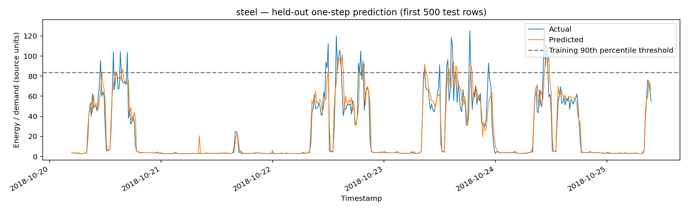
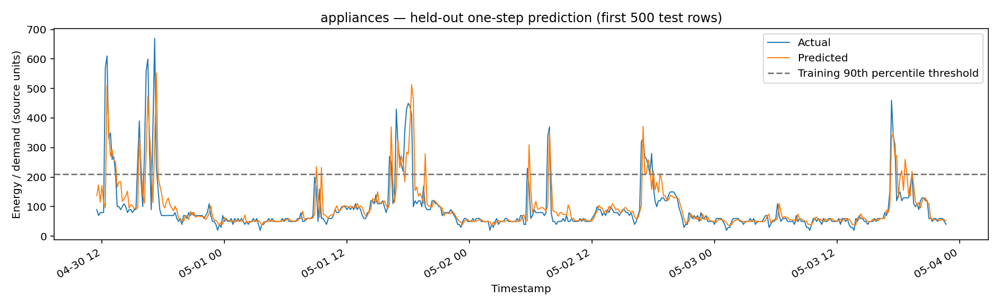
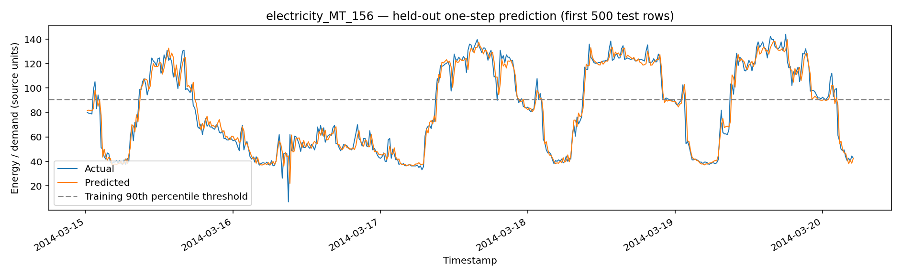
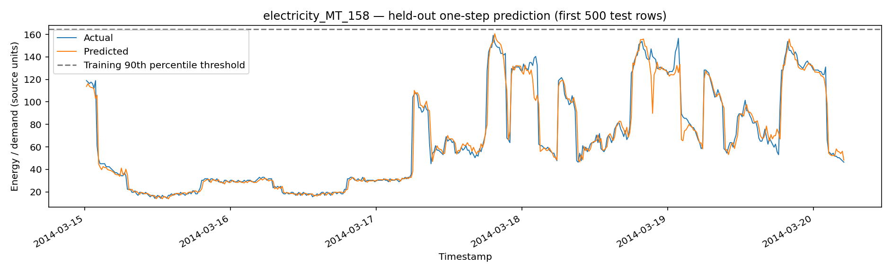
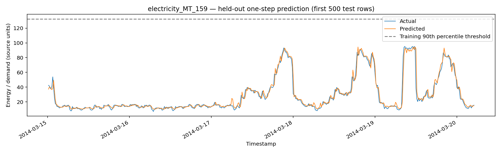
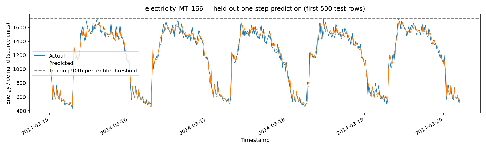
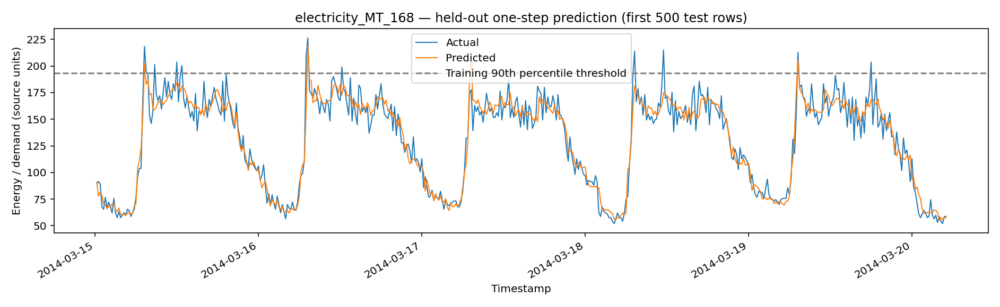
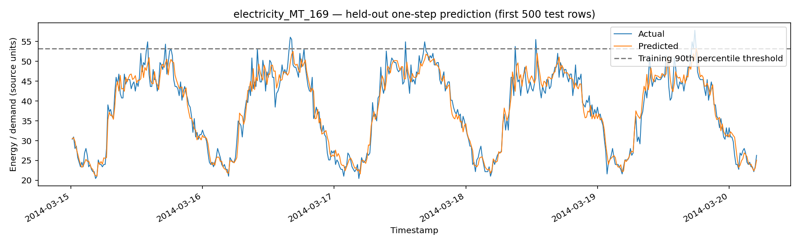
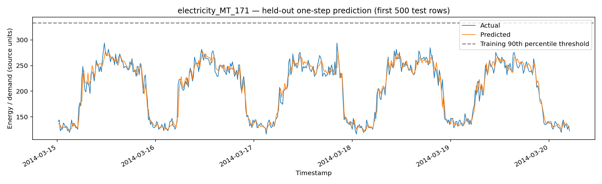
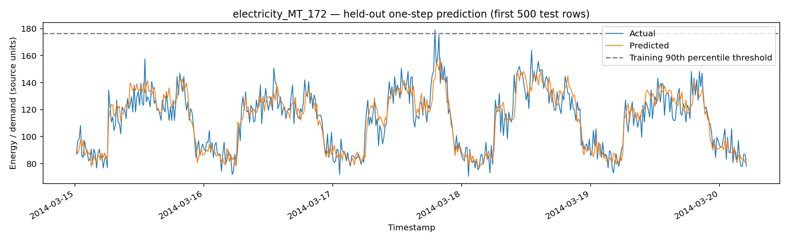
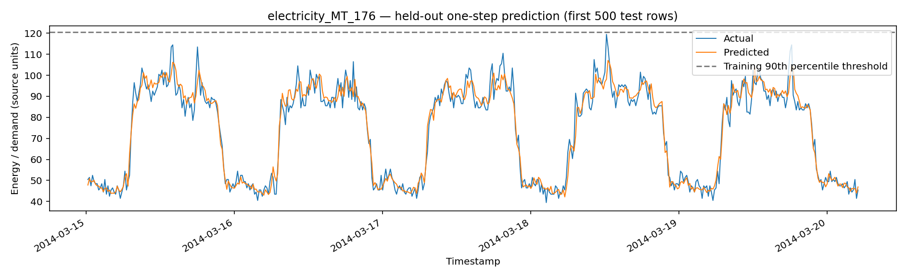
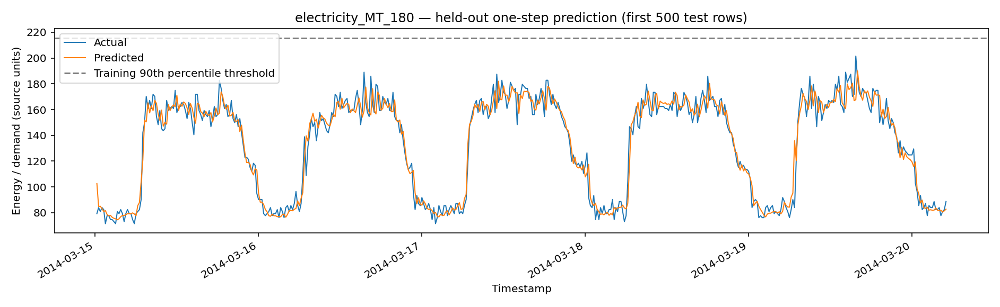
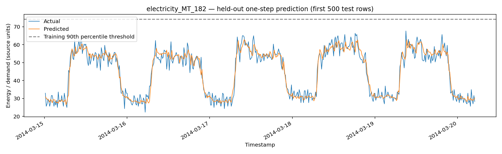
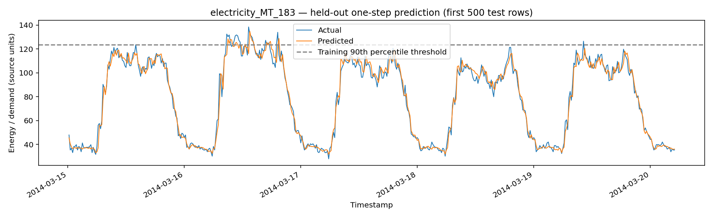


## 11. Arsitektur aplikasi dan API

**Lapisan riset:** notebook Kaggle menghasilkan laporan dan artifact model. **API:** FastAPI menyajikan health, daftar seri, metrik tersimpan, sampel forecast berpaginasi, laporan audit/manifest, serta inspeksi/prediksi model bersyarat. **UI:** React + Vite + TypeScript menyediakan Overview, Forecast Explorer, Model Inference, Research & Audit. Laporan adalah snapshot read-only. `GET /api/v1/health`, `/api/v1/series`, `/api/v1/series/{series_id}/metrics`, `/api/v1/series/{series_id}/forecast`, `/api/v1/reports/model-manifest`, `/api/v1/reports/{name}`, `/api/v1/models/{series_id}`, `POST /api/v1/predict/{series_id}`. Inferensi membutuhkan joblib lokal tepercaya, fitur historis bernama persis, dan versi sklearn kompatibel.

## 12. Struktur repositori

`notebooks/` notebook master; `data/{raw,interim,processed,external}/` dataset lokal di-ignore; `models/{baseline,champion}/` artifact lokal (tidak masuk Git); `reports/{audit,evaluation,experiments,forecasts}/` hasil tersimpan; `assets/plots/` empat belas PNG forecast asli; `assets/screenshots/` empat tangkapan layar aplikasi; `backend/app/` FastAPI; `frontend/src/` React; `docs/{en,id}/` dokumentasi berpasangan; `scripts/` alat bantu; `tests/` pemeriksaan; `LICENSE` MIT. Lihat `docs/id/repository-map.md` untuk peta lengkap.

```text
EnergyPeak Predictor/
├── README.md / AGENTS.md / LICENSE
├── notebooks/energypeak-predictor.ipynb
├── data/{raw,interim,processed,external}/
├── models/{baseline,champion}/ (local ignored artifacts)
├── reports/{audit,evaluation,experiments,forecasts}/
├── assets/{plots,screenshots,diagrams,examples}/
├── backend/{app,tests}/
├── frontend/src/{components,pages,services,styles,types}/
├── docs/{en,id}/
├── scripts/
└── tests/
```

## 13. Reproduksibilitas dan eksekusi

Input riset: `/kaggle/input/datasets/loliwibu/energypeak-predictor-dataset`; gunakan `notebooks/energypeak-predictor.ipynb`. Konfigurasi mencatat Python Kaggle **3.13.15** dan seed **42**; jangan menganggap versi Python notebook dan Windows lokal sama. Catat versi pandas, NumPy, scikit-learn, joblib, serta versi ekspor artifact sebelum menjalankan ulang. Sumber dapat diaudit melalui `source_provenance.csv`, `input_inventory.csv`, `run_config.json`, `research_gate.json`. Hasil ulang harus dibandingkan berdasarkan metrik dan hash agar bisa disebut reproduksi; status PASS saja tidak cukup.

## 14. Pengujian backend dan frontend

Backend: `cd backend`, aktifkan venv Python, `python -m pytest -q`, `python -m uvicorn app.main:app --reload --host 127.0.0.1 --port 8000`; periksa `/docs` dan `/api/v1/health`. Frontend: `cd frontend`, `npm install`, `npm run build`, `npm run dev`; buka `http://127.0.0.1:5173`. Uji integrasi manual: semua seri, pagination forecast dan empty state, schema model dan input 21 fitur yang sah, research gate, dan penanganan error. Screenshot membuktikan tampilan aplikasi lokal, bukan bukti seluruh rute/model lulus.

## 15. Deployment lokal dan daftar kesiapan produksi

Utamakan lokal. Simpan champion tepercaya di `models/champion/` dan laporan di `reports/` yang dilacak Git. Rahasiakan `.env`, batasi CORS, dan bind server ke localhost selama riset. Sebelum deployment internet dibutuhkan autentikasi, rate limiting, HTTPS, anggaran resource, uji keamanan, monitoring, dan izin sumber data; Random Forest besar dapat memakai ratusan MB per model. Tidak ada klaim validasi produksi.

```powershell
cd backend
py -3.11 -m venv .venv
.\.venv\Scripts\Activate.ps1
python -m pip install -r requirements.txt
python -m pytest -q
python -m uvicorn app.main:app --reload --host 127.0.0.1 --port 8000
```

```powershell
cd frontend
npm install
npm run build
npm run dev
```

## 16. Keterbatasan dan ancaman validitas

Holdout kronologis bersifat internal, bukan validasi eksternal; perubahan musim atau rezim dapat menurunkan performa. Rekayasa fitur bergantung pada ketersediaan pengukuran, jendela warm-up, dan unit yang benar. Eksperimen Electricity mencakup 12 dari 370 pelanggan terpilih, bukan seluruhnya. Dataset rumah tangga berinterval 10 menit. Belum ada kalibrasi ketidakpastian, confidence interval, koneksi live, grid dispatch, penghematan tarif, atau jaminan operasional. Klasifikasi puncak berasal dari prediksi dan ambang, bukan label pemadaman yang diaudit terpisah.

## 17. Pemecahan masalah

**API offline:** jalankan backend di venv dan cek health. **CORS:** periksa `VITE_API_BASE_URL` dan origin backend. **404 metrics:** pulihkan CSV/JSON ke lokasi report tepat. **503 model hilang:** file `models/champion/{series_id}_champion.joblib` belum ada lokal. **503 `ModuleNotFoundError: _loss`:** artifact diserialisasi dengan scikit-learn 1.6.1 tetapi backend sempat memakai 1.9.1; pasang/uji environment terpin kompatibel, bukan menyembunyikan error. **Model sebagian berhasil:** file ada != `joblib.load` berhasil. **422 fitur tidak cocok:** periksa `feature_columns`, lalu rekonstruksi lag/rolling tanpa nilai masa depan. **RAM penuh:** muat RF besar satu per satu. **npm audit:** telaah advisory dan uji perubahan, hindari `--force` membabi buta.

## 18. Peta jalan

**P0:** environment joblib kompatibel dan smoke test ke-14 seri; validasi setiap vektor fitur persis. **P1:** tes konsistensi report/plot otomatis, pengujian API/UI runtime, provenance/hash. **P2:** rolling-origin dan robustness musiman, pemeriksaan near-duplicate, uji drift seri/domain yang belum dilihat. **P3:** orkestrasi input terbatas dan pilot terkontrol; tidak ada kontrol energi otomatis tanpa kajian operasional independen.

## 19. Pertanyaan umum

**Apakah forecasting live?** Tidak, Forecast Explorer menampilkan evaluasi held-out historis. **Apakah 14/14 berarti 14 model bisa dimuat?** Tidak, itu hitungan file; loading perlu diuji terpisah. **Apakah tiga dataset digabung?** Tidak, eksperimen menjaga domain/interval. **Mengapa Peak F1?** Proksi event berbasis P90 train melengkapi MAE, bukan mengukur kondisi darurat jaringan. **Bolehkah forecast hanya dengan tanggal?** Tidak, estimator memerlukan fitur historis persis. **Apakah dataset asli disertakan?** Tidak, ambil sesuai hak dan provenance asal. **Apakah siap produksi?** Belum.

## 20. Lisensi dan hak data

Perangkat lunak repositori: MIT, lihat [`LICENSE`](../../LICENSE). Hak cipta 2026 Wafa Bila Syaefurokhman. Data UCI pihak ketiga, pengemasan Kaggle, gambar, serta dependency tetap mengikuti lisensi masing-masing. Verifikasi ketentuan penggunaan ulang sebelum mendistribusikan; jangan menganggap MIT otomatis berlaku pada dataset atau artifact yang dilatih darinya.

## 21. Berkas sumber kebenaran

Hasil numerik: `reports/evaluation/*_heldout_metrics.json`; kandidat validasi: `reports/evaluation/*_validation_candidates.csv`; inventaris eksperimen: `reports/experiments/all_experiment_metrics.csv`; CSV prediksi historis: `reports/forecasts/*_heldout_predictions.csv`; manifest champion: `reports/audit/model_manifest.csv`; konfigurasi: `reports/evaluation/run_config.json`; batas klaim: `reports/evaluation/claim_boundaries.json`; gerbang kesiapan: `reports/evaluation/research_gate.json`; asal data: `reports/evaluation/source_provenance.csv`; kode: `notebooks/energypeak-predictor.ipynb`, `backend/app/`, `frontend/src/`. README adalah indeks, bukan pengganti artifact data ini.
