# Visual Evidence — EnergyPeak Predictor

Dokumen ini memperluas bagian-bagian sumber kebenaran README utama. Semua angka dan keterbatasan mengacu pada keluaran repositori yang tersimpan.

## Bukti visual — screenshot dan semua plot

Empat belas gambar forecast di repositori memperlihatkan nilai aktual versus prediksi held-out untuk Steel, Appliances dan dua belas seri konsumen Electricity yang dievaluasi terpisah. Empat screenshot UI memperlihatkan konsol riset; plot maupun screenshot tidak membuktikan performa live atau kesiapan loading model.

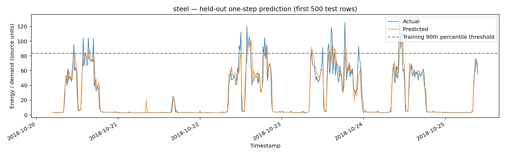
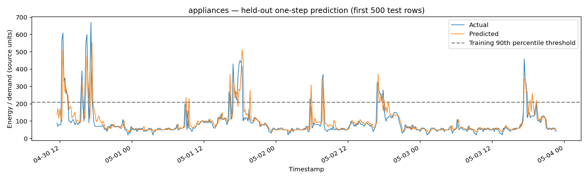
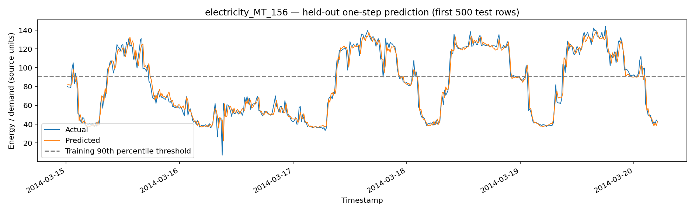
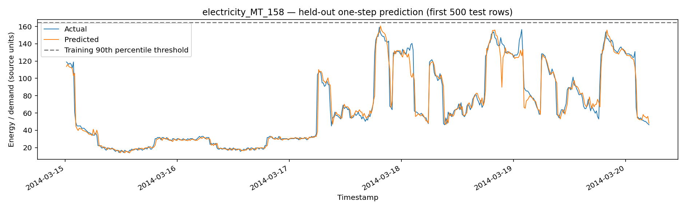
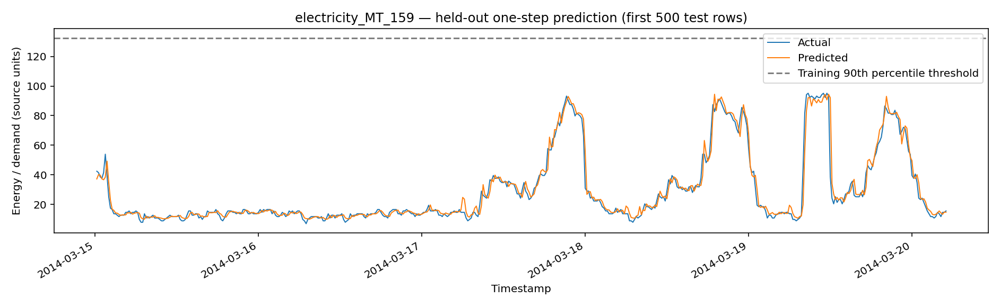
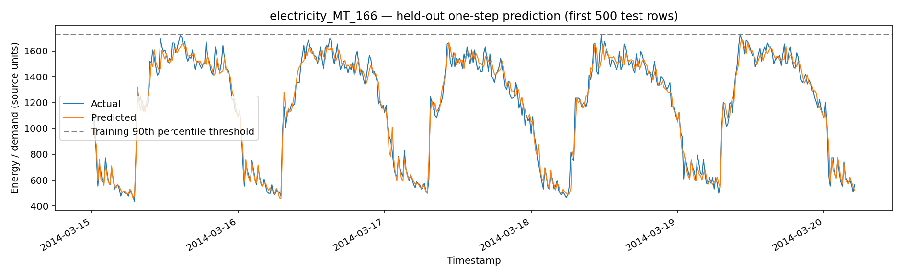
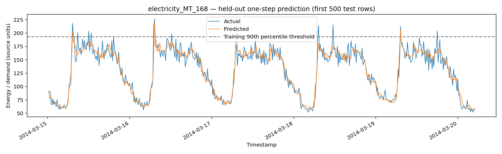
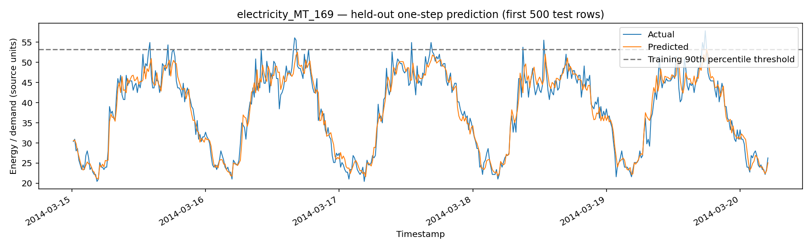
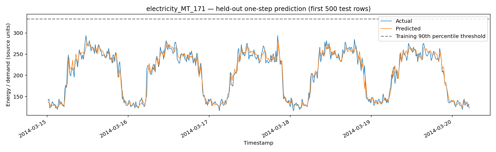
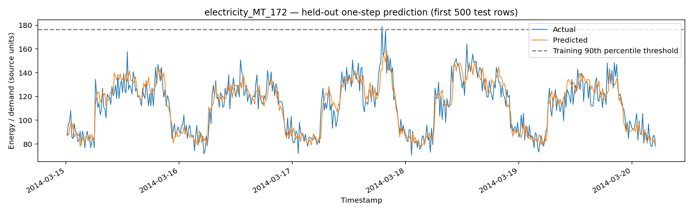
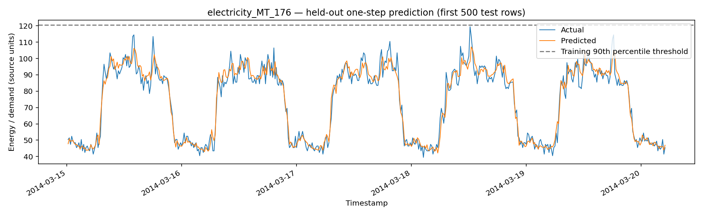
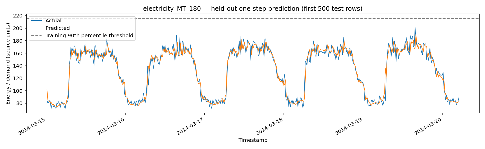
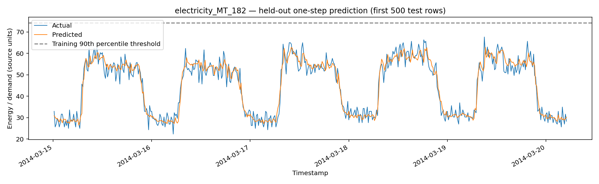
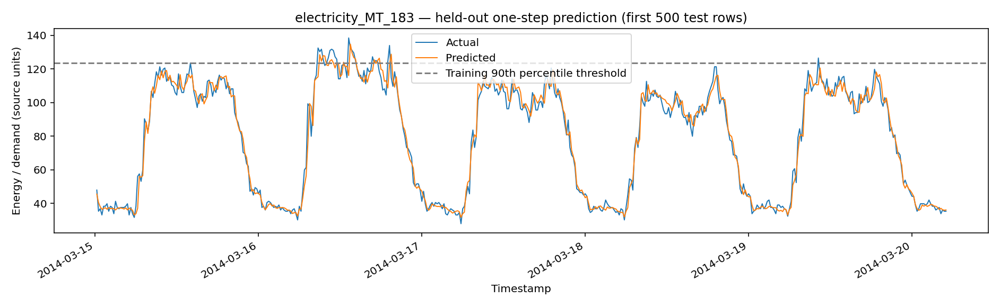

## Berkas sumber kebenaran

Hasil numerik: `reports/evaluation/*_heldout_metrics.json`; kandidat validasi: `reports/evaluation/*_validation_candidates.csv`; inventaris eksperimen: `reports/experiments/all_experiment_metrics.csv`; CSV prediksi historis: `reports/forecasts/*_heldout_predictions.csv`; manifest champion: `reports/audit/model_manifest.csv`; konfigurasi: `reports/evaluation/run_config.json`; batas klaim: `reports/evaluation/claim_boundaries.json`; gerbang kesiapan: `reports/evaluation/research_gate.json`; asal data: `reports/evaluation/source_provenance.csv`; kode: `notebooks/energypeak-predictor.ipynb`, `backend/app/`, `frontend/src/`. README adalah indeks, bukan pengganti artifact data ini.

## Metrik evaluasi held-out

Sumber: `reports/evaluation/{steel,appliances,electricity_MT_###}_heldout_metrics.json`. **Steel** (`random_forest_160`, 6.989 data test, kWh): MAE **3,9369**, RMSE **8,3710**, sMAPE **12,3215%**, Peak F1 **0,7314**, P90 train **83,74 kWh**. **Appliances** (`hist_gradient_boosting`, 3.928 data test, satuan energi asli dataset): MAE **25,3261**, RMSE **57,5269**, sMAPE **20,4713%**, Peak F1 **0,7117**. **Electricity MT_156** (`hist_gradient_boosting`, 28.032 data test, satuan asli): MAE **4,5920**, RMSE **6,5115**, sMAPE **5,7733%**, Peak F1 **0,9467**. Peak F1 memakai ambang P90 dari train dan tidak memvalidasi kegagalan jaringan secara independen. Jangan meranking MAE antarsatuan atau domain yang tidak sebanding.

## Path bukti

- `reports/evaluation/`
- `reports/forecasts/`
- `reports/experiments/`
- `reports/audit/`
- `notebooks/energypeak-predictor.ipynb`
